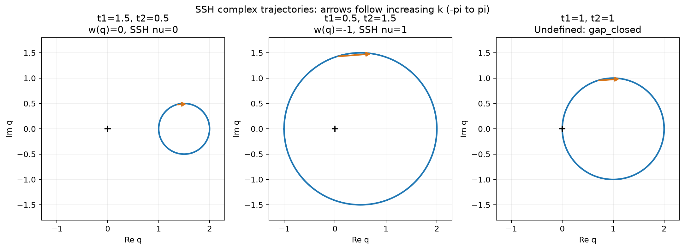
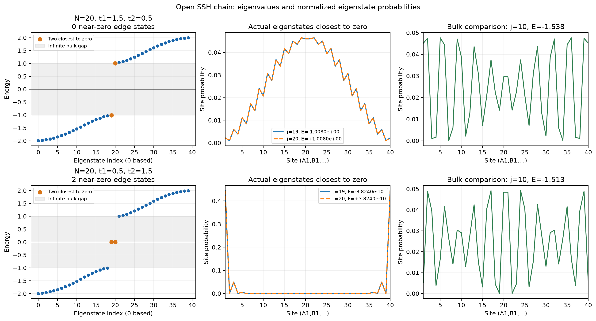
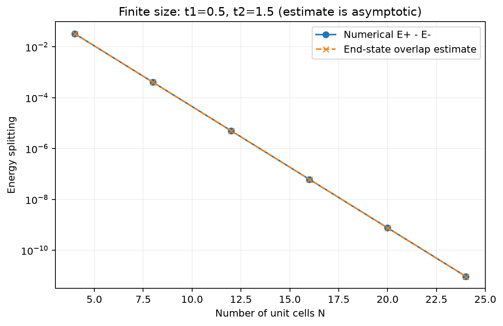

# SSH 绕数与有限开链：实际计算报告

日期：2026-10-24（Asia/Shanghai）。这是在现有项目上的增量开发；已有能带核心 `src/ssh_bands.py` 保持原样，计算前后 SHA-256 均为 `670c8d1bb26fee11c635f75d49962b3406aedd80d67beeae30ee668e65b36807`。未重建项目、增加依赖、实现 Zak 相位或启用多智能体。

## 记录的分工

- [物理假设与符号约定](../../notes/ssh_topology_assumptions.md)：模型、晶胞、边界、数值参数和判据。
- [理论预期与自行推导](../../notes/ssh_topology_expectations.md)：计算要对照的结论及适用前提。
- 本报告与 [summary.json](summary.json)：实际测量结果和本轮验证范围。
- [本科生阅读与必会公式](../../notes/ssh_topology_learning.md)：从傅里叶变换、绕数到端态递推的解释。

## 实际执行与参数

新增实现 `src/ssh_topology.py`，直接读取原有 Bloch 哈密顿量的上右元 q，不另写一份能带核心。绕数用相邻归一化 q 的相位增量求和；有限链使用 NumPy `eigh` 求完整本征能量、本征矢，尺寸比较使用 `eigvalsh`。

基底 (A,B)，a=1，k 递增，q=t1+t2 exp(-ik)，ν=-w_q；开放链基底 (A1,B1,...,AN,BN)，端点 A1、BN，切断 t2 键。体参数三组 (1.5,0.5)、(0.5,1.5)、(1,1)，网格 2001 点含两个区边界。开放链对前两组分别计算 N=20、40 格点；非平庸相再比较 N=4、8、12、16、20、24。

实际运行命令（在项目根目录的 PowerShell；两条均退出码 0）：

```powershell
& '.\.venv\Scripts\python.exe' -B -m src.ssh_topology --num-k 2001 --num-cells 20 --output-dir results/ssh_topology_run02
& '.\.venv\Scripts\python.exe' -B -m pytest -q -p no:cacheprovider --basetemp=results/logs/ssh_topology_pytest_tmp_run02 --junitxml=results/logs/ssh_topology_pytest_run02.xml tests
```

实际执行分别保留了计算和测试输出，并显式传递原程序退出码。仓库包含[历史 pytest 输出](../logs/ssh_topology_pytest_run02.txt)；原始计算输出和 JUnit XML 含机器信息，仅保留本地。`--basetemp` 使用项目内的新测试临时目录；复现时请换一个新目录名，pytest 会清理指定的测试临时目录。

不覆盖旧计算结果的常用复现命令：

```powershell
& '.\.venv\Scripts\python.exe' -B -m src.ssh_topology
& '.\.venv\Scripts\python.exe' -B -m pytest -q -p no:cacheprovider tests
```

第一条自动创建新的时间戳目录。历史 run01 全部保留：首轮 55 个测试通过；查看初版图后给保存操作加入紧致边界，防止 q 图横轴标题触及画布底部；另补充输出文件重新构成本征方程的集成测试，最终成为 56 个测试。没有失败测试或未解决计算错误。

运行环境：Python 3.13.14、NumPy 2.5.4、Matplotlib 3.11.2、pytest 9.1.1；现有 SciPy 1.18.1 可用，本轮计算不需要额外调用。没有安装或升级任何包。

## 绕数：测量与理论对照

| (t1,t2) | 数值原始 w_q | 数值原始 ν | 最终 ν / 理论预期 | 状态 |
| --- | --- | --- | --- | --- |
| (1.5,0.5) | +1.7669748230e-17 | -1.7669748230e-17 | 0 / 0 | 通过 |
| (0.5,1.5) | -0.9999999999999997 | +0.9999999999999997 | 1 / 1 | 通过 |
| (1,1) | 未计算相位和 | 未赋值 | 不定义 / 不定义 | 正确拒绝赋值 |



前两组数值采样的 min abs(q) 均为 1，圆形轨迹的独立解析距离也为 1。第三组采样残差为 1.2246467991e-16，精确几何距离为零；这是区边界复指数的浮点残差，不是物理小隙。第三组 q 穿过原点，不能报告 ν=0、1 或半整数。summary.json 中其整数和原始相位和均为 null，状态 gap_closed。

测试还实际检查了 101、1001、2001 点的有隙结果一致、能量整体缩放不变、临界三种网格拒绝赋值；对接近临界的 (0.999,1) 粗网格返回 grid_unresolved，加密到 10001 点得到 ν=1，交换参数得到 ν=0。非零但低于相对阈值的小隙另标 gap_unresolved；这与严格临界点的物理不定义不同。

## 开链：测量与理论对照

近零判据：abs(E)<0.01 abs(t1-t2)=0.01；局域性判据：左右各三个晶胞的概率之和 ≥0.9。两项必须同时成立。

| (t1,t2) | 距零最近的两个本征值 | 每态的两端总概率 | 满足两项判据的态数 | 理论对照 |
| --- | --- | --- | --- | --- |
| (1.5,0.5) | -1.007964679、+1.007964679 | 0.06494108、0.06494108 | 0 | 平庸相无近零端态，符合 |
| (0.5,1.5) | -3.823962522e-10、+3.823962787e-10 | 0.99862826、0.99862826 | 2 | 非平庸相一对近零端态，符合 |



图的左列为完整能谱，灰区为无限链体隙；中列为实际求得的两个最靠近零的本征态，右列是远离隙的体态对照。概率按格点绘制，包含 A/B 交替结构。两条中列概率曲线近乎重合，是本征态的实际性质。

非平庸相每个态左端三胞概率约 0.49931413、右端三胞同样约 0.49931413。它们是左右端态杂化后的能量本征态，不能声称一个本征态只在左端、另一个只在右端。测试实际检查其靠近左端的相邻晶胞概率比例为 (t1/t2)²=1/9。

本征方程的最大逐元素残差：平庸相 9.437e-16，非平庸相 1.055e-15；最大正交归一误差均为 1.776e-15；最大 ±E 配对误差均为 1.332e-15，均低于约定容差。原有 16 项能带测试也全部通过。

## 有限尺寸：实际劈裂

固定 t1=0.5、t2=1.5，报告 ΔE=E_positive-E_negative，不混同于单个正能量的绝对值。

| N | 数值 ΔE | 截断端态重叠近似 ΔE |
| --- | --- | --- |
| 4 | 3.29391184e-2 | 3.29268293e-2 |
| 8 | 4.06442173e-4 | 4.06442117e-4 |
| 12 | 5.01780380e-6 | 5.01780380e-6 |
| 16 | 6.19481950e-8 | 6.19481950e-8 |
| 20 | 7.64792531e-10 | 7.64792531e-10 |
| 24 | 9.44188310e-12 | 9.44188310e-12 |



六个长度均有可分辨的一负一正近零能量，劈裂单调下降；与报告中明确标为近似的公式相差均小于 2%（最短 N=4 约 0.0373%）。这验证了所测长度和参数下的指数趋势。N=4 的 |E| 约 0.01647，未达到主图采用的 0.01 近零阈值；短链阈值分类失败并不自动推翻无限体系的非平庸绕数。

尺寸表来自仅求本征值的 eigvalsh，主图来自求本征矢的 eigh；两种求解路径最后几位有浮点差异，均不将其解释为物理不对称。更长链的劈裂最终会低于双精度分辨率，本轮未对那个区间声称测得精确劈裂。

## 自动测试与验证边界

最终实际结果：**56 passed in 1.86s；0 failed、0 errors、0 skipped**。其中原有能带 16 项、新增 40 项。

新增测试覆盖：绕数符号和网格一致性、q 的固定点及圆几何、临界与数值不可分辨保护、能量缩放；开链精确键位置与终止方式、周期补键后傅里叶投影复现旧 Bloch 矩阵、厄米/手征对称、本征方程及归一化、±E 配对；近零与端部局域联合判据、衰减比例、两种完全二聚化极限、均匀开链独立解析谱、尺寸劈裂趋势及近似对照；非法输入、端部窗口限制，以及输出 CSV 重新构成本征方程、JSON 与 PNG 输出、拒绝覆盖旧目录。

本轮验证限于上述无相互作用、无无序、保持手征对称的模型和明确终止方式；没有执行一般扰动稳定性或不同终止方式研究。理论上的拓扑保护不能冒充已经逐项数值验证的结论。

## 文件索引

- 三张 PNG：复轨迹、开放链能谱/概率、尺寸劈裂。
- `q_*.csv` 三份：k、Re q、Im q、abs q，含临界轨迹。
- `spectrum_*.csv` 两份：从零开始的态编号、能量、两端窗口总概率。
- `states_*.csv` 两份：实本征矢；每行依次对应 A1,B1,...,A20,B20，每列对应按能量排序的态编号 0,...,39。为实厄米矩阵，本轮本征矢可取实数，任意整体符号不影响概率。
- `probabilities_*.csv` 两份：同样的行列顺序，值为对应本征矢的模平方。
- `finite_size.csv`：N、两个中心能量、数值劈裂、近似劈裂、谱配对误差。
- `summary.json`：实际参数、版本、命令、原始数值、判据及逐项计算自检。
- 仓库测试证据为[历史 pytest 文本](../logs/ssh_topology_pytest_run02.txt)；原始完整性清单和 XML 仅保留本地，历史哈希可能对应脱敏前文件。

## 仓库共享说明

本报告仅调整材料索引；数值结论不变。summary.json 已脱敏机器路径。原始报告、日志、run01 与测试临时文件保留在本地。历史命令用于追溯，复跑请使用上方自动创建新目录的命令，勿覆盖旧临时目录。
